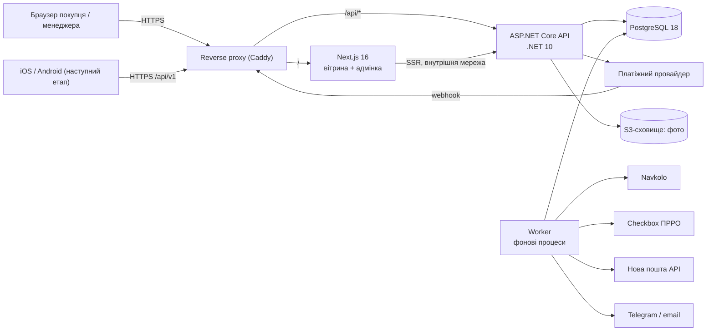
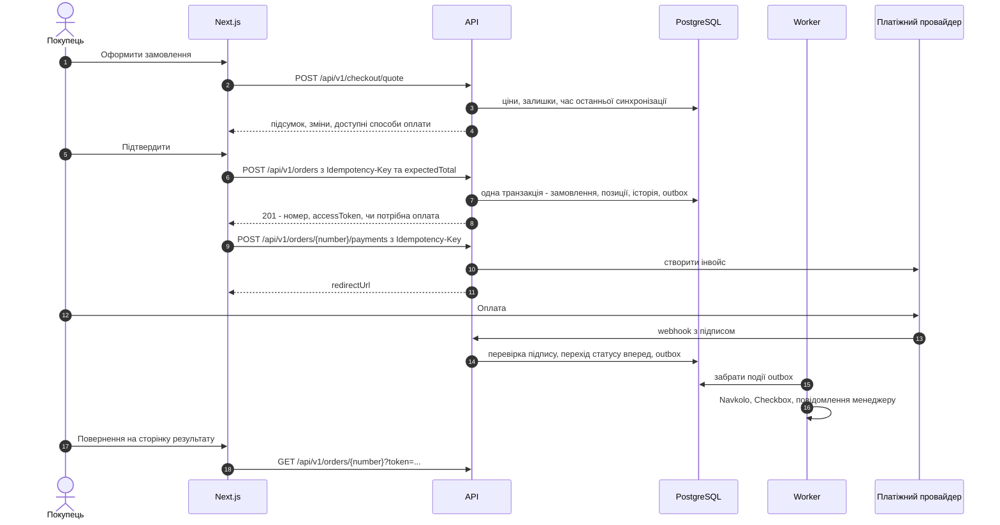

# Poli Valko — пропозиція технічного рішення

> До ТЗ «Інтернет-магазин · Перший публічний запуск» (редакція від 26.10.2026, зі спільним ASP.NET Core API).
> Стан дослідження: 28.10.2026.

## 0. Коротко

- **Архітектура.** Модульний моноліт на ASP.NET Core (.NET 10 LTS), окремий процес для фонових задач (Worker), PostgreSQL 18, Next.js 16 для вітрини та адмінки. Усі бізнес-правила живуть тільки в API. Next.js відповідає лише за рендеринг та інтерфейс і не має доступу до БД.
- **Один домен.** Reverse proxy направляє `/` у Next.js, а `/api/` в ASP.NET Core. Cookie адмінки стають first-party, тож для вебу не потрібен CORS, а CSRF закривається стандартним antiforgery.
- **Надійність.** Transactional outbox у PostgreSQL, ключі ідемпотентності для замовлень і платежів, машина станів платежу, що рухається лише вперед, і фонова звірка платежів, які «зависли».
- **Інтеграції за адаптерами:** `IErpGateway` (Navkolo), `IPaymentProvider`, `IFiscalService` (Checkbox), `IDeliveryDirectory` (Нова пошта). Зовнішні сервіси підміняються фейками в тестах і на тестовому контурі.
- **Головний ризик.** **Navkolo не має публічної документації API.** Розділ 7 ТЗ (синхронізація кожні 5 хв, передача замовлень, резерв) поки спирається на припущення. Це треба закрити в етапі 0, до фіксації строків.

---

## 1. Результати дослідження

| Тема | Що з'ясовано | Наслідок для проєкту |
|---|---|---|
| **Navkolo** | SaaS-екосистема для МСБ: бухгалтерія, «Торгівля» (склад, ціни, акції), онлайн-торгівля/CRM, власний модуль ПРРО. У «Торгівлі» є розділ «API та інтеграції», але без технічних деталей. Готові інтеграції: Prom, Rozetka, Хорошоп, WooCommerce, OpenCart, Нова пошта, Укрпошта; ПРРО через Checkbox; банки ПриватБанк, monobank, Plata by mono. Сторонні інтегратори синхронізують товари, ціни, залишки й замовлення, але публічних ендпоінтів, лімітів і вебхуків немає. Резервування на сайті не згадується. | Отримати доступ і документацію через підтримку або партнерську програму. Провести технічний PoC до оцінки. Резерв не обіцяти. Закласти запасні сценарії (§8.2). |
| **.NET** | .NET 10 і EF Core 10 мають LTS до листопада 2028. .NET 11 (листопад 2026) — це STS. | .NET 10 + EF Core 10 + Npgsql. |
| **PostgreSQL** | Поточна гілка 18 (18.6). Реліз PG 19 перенесено на 19.11.2026. | Стартуємо на PG 18: вбудований `uuidv7()`, асинхронний I/O. |
| **Next.js** | Поточний мажор 16 (16.4.x). У 2025–2026 роках виходили критичні security-релізи. | Next.js 16 + React 19, фіксуємо версії, Renovate/Dependabot і регламент оновлення. |
| **monobank (Plata by mono)** | Вебхук на зміну статусу інвойсу підписаний ECDSA (заголовок `X-Sign`), публічний ключ береться з `/api/merchant/pubkey`. Доставку повторюють до 3 разів, порядок доставки не гарантований. Чеки можуть видаватися автоматично через Checkbox та інші сервіси. | Перевіряємо підпис, звіряємо статус через API і запускаємо фонову звірку незавершених платежів. |
| **Checkbox (ПРРО)** | REST API: `POST /api/v1/receipts/sell` створює чек, фіскалізує його й надсилає покупцю. Є інтеграція з Новою поштою: чек прив'язується до ТТН при післяплаті. З 2025 року для безготівки треба вказувати форму оплати «Платіж через інтегратора <назва>». | Основний кандидат для онлайн-фіскалізації. Navkolo вже працює з Checkbox, тож можна використати касу продавця. |
| **Післяплата NovaPay** | За публікаціями юристів, суди (зокрема ВС у липні 2025) визнали, що при післяплаті продавець не є стороною розрахунку і не зобов'язаний застосовувати РРО. Позиція ДПС раніше була протилежною. | Рішення приймає бухгалтер продавця. Технічно підтримуємо обидва варіанти (§8.5). |

---

## 2. Аналіз ТЗ: прогалини й ризики

| # | Питання | Ризик | Що пропонуємо |
|---|---|---|---|
| R1 | API Navkolo: доступ, ліміти, інкрементальне завантаження, передача замовлень, акційні ціни | **Критичний** | Етап 0: PoC на реальному акаунті. Без нього строки розділу 7 не фіксуються. Запасні сценарії описано в §8.2. |
| R2 | Одночасний продаж онлайн і в магазині без резерву | Високий | Буфер безпечного залишку. Для «останніх штук» — підтвердження менеджером перед оплатою. У текстах прямо пишемо, що наявність підтверджує менеджер (§8.3). |
| R3 | Фіскалізація: онлайн, післяплата, самовивіз, повне й часткове повернення | Високий | До розробки погодити з бухгалтером матрицю сценаріїв (§8.5). Уточнити, чи платник ПДВ продавець і які податкові групи в чеку. |
| R4 | Контент для ~5 000 SKU (фото, описи, характеристики) | Високий для строків | Звіт про якість імпорту. Плейсхолдер для фото. Окремо погодити правило: товар без фото чи опису публікується або ні. Масове наповнення не входить у технічний імпорт (як і в ТЗ). |
| R5 | Акційні ціни «за логікою Navkolo» | Середній | Якщо API не віддає стару ціну або період акції, показуємо лише поточну ціну. Власних правил знижок на сайті не робимо. |
| R6 | Вага й габарити для обмежень доставки (поштомати) | Середній | Якщо в Navkolo цих даних немає, ставимо прапорці на категорії чи товарі: «лише відділення», «лише самовивіз». |
| R7 | Назва товару: власник поля не визначений | Середній | Назва приходить із Navkolo. На сайті є необов'язкове поле «назва для вітрини». Погодити. |
| R8 | «Один погоджений канал» повідомлень менеджеру | Низький | Пропонуємо Telegram-бот у робочий чат, резервний канал — email. |
| R9 | Навантаження: «погоджена кількість» не задана | Середній | Базова пропозиція: 200 одночасних відвідувачів і 30 замовлень/хв у піку. p95 API каталогу < 300 мс, оформлення < 800 мс без зовнішніх викликів. |
| R10 | Персональні дані | Середній | Строк зберігання даних гостьових покупців. Згода з офертою під час оформлення. Cookie-банер і GA4 Consent Mode v2. Маскування телефону в логах. |
| R11 | Доступність описана без стандарту | Низький | Орієнтир — WCAG 2.2 AA для ключових сценаріїв: каталог, товар, кошик, оформлення. |
| R12 | Категорія «Хлам», варіанти товарів | Середній | Вирішуємо під час мапінгу. За замовчуванням «Хлам» не імпортується у вітрину. |
| R13 | Адмінка й API на різних доменах ускладнюють cookie, CSRF і CORS | Середній | Один домен із маршрутизацією за шляхом (§3.2). |

---

## 3. Архітектура



### 3.1 Принципи

1. **API — єдине місце бізнес-правил.** Ціни, підсумки, наявність, статуси й права перевіряє тільки сервер. Next.js не має рядка підключення до БД і не використовує Server Actions для бізнес-операцій: усі мутації йдуть звичайними HTTP-запитами на `/api/v1`. Ті самі запити пізніше використовуватимуть мобільні застосунки.
2. **Модульний моноліт.** Модулі: Catalog (з цінами й залишками), Cart & Checkout, Orders, Payments, Fiscal, Delivery, Integration.Navkolo, Content (сторінки, послуги, звернення), Identity & Audit, Notifications. Одна БД зі схемою на модуль. Замовлення та подія outbox пишуться в одній транзакції EF Core. Межі модулів перевіряють архітектурні тести.
3. **Два процеси з одного рішення.** API (stateless, масштабується горизонтально) і Worker (outbox, розклад, інтеграції). Робота фонових задач не залежить від браузера, а їхній стан зберігається в PostgreSQL.
4. **Внутрішні сутності ≠ контракт.** API повертає окремі DTO. Мапінг пишемо вручну, явно.

### 3.2 Домени, сесії, авторизація

- **Один origin** (`https://<домен>`): `/` і `/admin` обслуговує Next.js, `/api/` — ASP.NET Core. Для вебу CORS вимкнений. Для майбутніх клієнтів, якщо знадобиться, вмикається allowlist.
- **Адміністратори.** ASP.NET Core Identity з окремими обліковими записами й ролями `Admin` / `Manager`, політики авторизації на кожному ендпоінті.
  - Cookie `__Host-pv_admin` з атрибутами `HttpOnly`, `Secure`, `SameSite=Strict`, `Path=/`.
  - CSRF: antiforgery-токен у заголовку `X-CSRF-TOKEN` на всіх змінних методах.
  - Блокування після невдалих спроб входу, rate limiter на `/login`, TOTP-2FA для ролі `Admin` (рекомендовано).
  - Ключі Data Protection зберігаються в БД, щоб сесії переживали перезапуски.
  - Жодних токенів у `localStorage`.
- **Гості.** Облікових записів немає. Сторінку результату замовлення відкривають за непрогнозованим `accessToken` (128 біт) у посиланні, тому номери замовлень неможливо перебрати.
- **Мобільні (наступний етап).** API наперед підтримує другу схему, JWT Bearer, і вибирає схему за заголовком `Authorization`. Видавець токенів — OIDC-сервер з Authorization Code + PKCE: OpenIddict у тому ж рішенні або зовнішній провайдер. Вибір погоджується на відповідному етапі, власний протокол не пишемо.

---

## 4. Стек

| Шар | Вибір | Обґрунтування |
|---|---|---|
| API | .NET 10 LTS, ASP.NET Core Minimal APIs: групи ендпоінтів по модулях, `TypedResults` | LTS до 11.2028. Вбудована валідація Minimal APIs у .NET 10. Точні типи відповідей в OpenAPI. |
| OpenAPI | Вбудований `Microsoft.AspNetCore.OpenApi` (OpenAPI 3.1) + Scalar UI (на staging або під авторизацією) | Опис генерується з коду, а `oasdiff` у CI блокує несумісні зміни v1. |
| Дані | EF Core 10 + Npgsql, PostgreSQL 18, розширення `pg_trgm` і `unaccent` | Версіоновані міграції. Пошук за назвою з толерантністю до помилок, точний збіг за артикулом. |
| Фонові задачі | Власний outbox (`FOR UPDATE SKIP LOCKED`) + планувальник на `PeriodicTimer` з advisory lock | Без зовнішнього брокера. Стан і помилки видно в адмінці, є ручний повтор. |
| Проблеми | `AddProblemDetails` + `IExceptionHandler`, RFC 9457 | Єдиний формат помилок (§7.2). |
| Спостережуваність | OpenTelemetry (трейси, метрики), структуровані логи, Sentry або Grafana Cloud | Моніторинг помилок і доступності вимагає ТЗ. |
| Вітрина й адмінка | Next.js 16 App Router, React 19, TypeScript, Tailwind CSS 4, Onest через `next/font` | Серверний HTML для SEO. Адмінка — route group `/admin` з клієнтським рендерингом і TanStack Query. |
| API-клієнт у вебі | Типи генеруються з OpenAPI (`openapi-typescript` + `openapi-fetch`) | Розбіжність контракту видно на етапі компіляції. З того самого опису пізніше генеруються клієнти для Swift і Kotlin. |
| Тести | xUnit, Testcontainers (PostgreSQL), `WebApplicationFactory`, Playwright, k6, Lighthouse CI | Див. §13. |
| Інфраструктура | Docker Compose на VPS (staging + prod), Caddy (авто-HTTPS), S3-сумісне сховище, GitHub Actions у репозиторії замовника | Відтворюване розгортання. Для 5 000 SKU цього достатньо із запасом. |

> **Ліцензії.** У 2025 році MediatR, AutoMapper, MassTransit v9 і FluentAssertions v8 перейшли на комерційні ліцензії, тому в проєкт їх не беремо. Мапінг пишемо вручну, в тестах використовуємо Shouldly або вбудовані асерти.

---

## 5. Структура репозиторію

```
polivalko/
├─ src/
│  ├─ PoliValko.Api/                 # хост: ендпоінти, auth, OpenAPI, ProblemDetails, rate limiting
│  ├─ PoliValko.Worker/              # хост: outbox-диспетчер, розклад синхронізацій
│  ├─ PoliValko.Infrastructure/      # DbContext, міграції, outbox, ідемпотентність, S3
│  ├─ Modules/
│  │  ├─ PoliValko.Catalog/          # категорії, товари, атрибути, фільтри, ціни, залишки
│  │  ├─ PoliValko.Checkout/         # кошик, quote, створення замовлення
│  │  ├─ PoliValko.Orders/           # замовлення, статуси, скасування, повернення
│  │  ├─ PoliValko.Payments/         # провайдер, вебхуки, звірка, refund
│  │  ├─ PoliValko.Fiscal/           # Checkbox: чеки продажу та повернення
│  │  ├─ PoliValko.Delivery/         # Нова пошта (довідники), самовивіз
│  │  ├─ PoliValko.Integration.Navkolo/
│  │  ├─ PoliValko.Content/          # сторінки, послуги, звернення, контакти
│  │  ├─ PoliValko.Identity/         # працівники, ролі, журнал аудиту
│  │  └─ PoliValko.Notifications/    # Telegram, email
│  └─ PoliValko.SharedKernel/        # Money, Result, доменні події, час
├─ web/                              # Next.js: (shop) і admin
├─ tests/
│  ├─ PoliValko.UnitTests/
│  ├─ PoliValko.IntegrationTests/    # HTTP-тести API + PostgreSQL у Testcontainers
│  ├─ PoliValko.ArchitectureTests/
│  ├─ e2e/                           # Playwright
│  └─ load/                          # k6
├─ deploy/                           # compose, Caddyfile, скрипти бекапу
└─ docs/                             # ADR, мапінг полів, матриця фіскалізації, runbook
```

---

## 6. Модель даних

**Схема `catalog`**
- `categories`: дерево, `slug`, порядок, видимість, `navkolo_ref`. Верхній рівень — 8 категорій Navkolo, підкатегорії налаштовуються в адмінці.
- `products`: `id` (UUIDv7), `navkolo_id` (unique), `sku`, `barcode`, `name`, `display_name`, `slug`, `brand_id`, `description_html`, `is_visible`, SEO-поля, `variant_group_id`.
- `product_prices`: `price`, `old_price`, `updated_at`. `product_stock`: `quantity`, `updated_at`. Ціни й залишки винесено окремо, тому синхронізація раз на 5 хв оновлює лише маленькі рядки.
- `product_images` (ключ у S3, порядок, alt), `brands`.
- `attributes` (тип: перелік, число, так/ні, текст), `attribute_options`, `product_attribute_values`, `category_filters` (погоджений перелік фільтрів на кожну категорію).
- `collections` (добірки головної), `slug_redirects` (історія URL для 301).

**Схема `ordering`**
- `carts`, `cart_items`.
- `orders`: людиночитний `number` із послідовності, `access_token_hash`, `status`, контактні дані, спосіб отримання, відділення або адреса, спосіб оплати, коментар, суми, `seller_id`, `erp_state`, `created_at`, `xmin` для оптимістичної конкуренції.
- `order_items`: знімок назви, артикулу й ціни на момент покупки. `order_status_history`: хто, коли, з якого статусу в який, причина.
- `sellers`: юридичний продавець. На старті він один, але замовлення, платіж і чек уже посилаються на `seller_id`. Перехід до кількох продавців не потребує зміни структури.

**Схеми `payments`, `fiscal`, `delivery`**
- `payment_attempts`: провайдер, `provider_invoice_id`, сума, статус, `modified_at` від провайдера. `payment_events`: сирий payload, результат перевірки підпису, ключ дедуплікації.
- `receipts`: тип (продаж / повернення), позиції, фіскальний номер, посилання на чек, статус.
- `np_settlements`, `np_warehouses` (з поштоматами), `pickup_points`.

**Схеми `integration`, `content`, `identity`**
- `outbox_messages`: тип, payload, `attempts`, `next_attempt_at`, `status`, `last_error`. Ще `idempotency_keys`, `sync_runs` і `sync_errors`.
- `pages`, `service_directions`, `service_requests`, `site_settings` (контакти, графік).
- Таблиці ASP.NET Identity, `audit_log` (хто, що, до/після у JSONB, коли).

### 6.1 Власник полів (чернетка для мапінгу)

| Поле | Джерело істини | Редагується на сайті |
|---|---|---|
| ID Navkolo, артикул, штрихкод | Navkolo | Ні |
| Ціна, стара/акційна ціна | Navkolo | Ні |
| Залишок | Navkolo | Ні |
| Категорія Navkolo | Navkolo | Ні (мапінг на підкатегорії сайту — у адмінці) |
| Назва | Navkolo | Опційне поле «назва для вітрини» |
| Бренд | Navkolo, якщо є; інакше сайт | Так, якщо не з Navkolo |
| Опис, фото, характеристики, SEO, видимість, добірки | Сайт | Так |
| Вага, габарити | Погодити | Погодити |

Адмінка показує поля Navkolo лише для читання з позначкою джерела. Синхронізація ніколи не перезаписує поля, які належать сайту.

---

## 7. Контракт API v1

### 7.1 Угоди

- Префікс `/api/v1`, JSON у camelCase, UTF-8, тільки HTTPS.
- **Ідентифікатори:** UUIDv7 у вигляді рядків. Замовлення додатково має людиночитний `number`.
- **Гроші:** `{"value": "1299.00", "currency": "UAH"}`. Десяткове число передається рядком, щоб уникнути похибок float у JS, Swift і Kotlin. Усі суми рахує тільки сервер.
- **Час:** події передаються в RFC 3339 у UTC (`2026-10-28T10:15:00Z`). Бізнес-дати (`2026-10-28`) рахуються в часовому поясі `Europe/Kyiv`, що записано в описі API.
- **Пагінація:** `?page=1&pageSize=24` (максимум 100), відповідь має вигляд `{items, page, pageSize, totalItems, totalPages}`.
- **Сортування:** `sort=price_asc|price_desc|name_asc|name_desc|relevance`.
- **Ідемпотентність:** заголовок `Idempotency-Key` (UUID) на `POST /orders`, `POST /orders/{number}/payments` та на адмінських поверненнях коштів. Ключ зберігається 72 години. Повтор із тим самим ключем повертає той самий результат. Той самий ключ з іншим тілом дає 422 `idempotency.key_mismatch`, запит, що ще виконується, — 409.
- **Конкурентні зміни в адмінці:** `ETag` / `If-Match`, при конфлікті відповідь 412.
- **Версіонування:** несумісна зміна означає випуск `/api/v2` з погодженим періодом паралельної підтримки v1. CI порівнює OpenAPI з опублікованим і падає на breaking change.

### 7.2 Формат помилки

```json
{
  "type": "https://<домен>/problems/checkout.price-changed",
  "title": "Ціни змінилися",
  "status": 409,
  "code": "checkout.price_changed",
  "detail": "Ціна 1 товару змінилася з моменту розрахунку.",
  "changes": [
    { "productId": "0192f...", "oldPrice": {"value": "450.00", "currency": "UAH"}, "newPrice": {"value": "480.00", "currency": "UAH"} }
  ],
  "traceId": "00-4bf9..."
}
```
Помилки валідації мають `status: 400`, `code: "validation.failed"` і поле `errors: { "phone": ["Невірний формат номера"] }`. Стек-трейси та внутрішні повідомлення клієнтам не віддаються.

### 7.3 Ендпоінти першого запуску

**Публічні**
| Метод | Маршрут | Призначення |
|---|---|---|
| GET | `/categories` | Дерево категорій |
| GET | `/categories/{slug}` | Категорія, хлібні крихти, доступні фільтри |
| GET | `/products` | Пошук, фільтри, сортування, пагінація + фасети (`category`, `q`, `brand`, `priceMin/priceMax`, `inStock`, `attr.<код>=…`) |
| GET | `/products/{slug}` | Картка товару, варіанти |
| GET | `/search/suggest?q=` | Підказки за назвою й артикулом |
| GET | `/home` | Блоки головної: категорії, рекомендовані, пропозиції, послуги |
| POST/GET | `/carts`, `/carts/{cartId}` | Серверний кошик (ID непрогнозований) |
| PUT/DELETE | `/carts/{cartId}/items/{productId}` | Кількість, видалення |
| POST | `/checkout/quote` | Перерахунок: ціни, наявність, свіжість даних, способи оплати й доставки |
| POST | `/orders` | Створення замовлення (`Idempotency-Key`, `expectedTotal`) |
| GET | `/orders/{number}?token=` | Статус для сторінки результату |
| POST | `/orders/{number}/payments` | Створити або відкрити повторно онлайн-оплату |
| POST | `/webhooks/payments/{provider}` | Повідомлення провайдера (перевіряється підпис) |
| GET | `/delivery/np/settlements?q=`, `/delivery/np/warehouses?settlementRef=&q=&type=` | Довідники Нової пошти з локальної копії |
| GET | `/delivery/pickup-points` | Самовивіз у Бучі: адреса, графік, інструкція |
| POST | `/service-requests` | Заявка на послугу (rate limit + honeypot) |
| GET | `/pages/{slug}`, `/site/settings` | Текстові сторінки, контакти |
| GET | `/seo/sitemap`, `/seo/redirects` | Дані для sitemap і 301-перенаправлень |

**Адміністративні** (`/api/v1/admin/...`, ролі перевіряються на кожному методі)
- `auth/login`, `auth/logout`, `auth/me`, `auth/csrf`, `auth/2fa`.
- `orders`: список і пошук за номером або телефоном, картка, перехід статусу, скасування, повернення коштів (повне чи часткове), коментар.
- `catalog`: товари (тільки поля сайту), фото, характеристики, SEO, видимість, підкатегорії, мапінг на Navkolo, добірки, фільтри категорій.
- `service-requests`, `pages`, `settings`.
- `sync`: стан, запуски, помилки, ручний повтор, повторна відправка замовлення в Navkolo.
- `users`, `roles`, `audit-log` (лише `Admin`).

---

## 8. Ключові сценарії

### 8.1 Оформлення та оплата



Правила:
- **Ціна змінилася.** Якщо `expectedTotal` не збігається з перерахованою сумою, API повертає 409 `checkout.price_changed` разом зі списком змін. Нестача залишку дає 409 `checkout.insufficient_stock`. Покупець бачить зміни до підтвердження.
- **Дані застаріли або ERP недоступна.** Якщо остання успішна синхронізація старша за поріг (пропонуємо 30 хв, погодити), замовлення створюється як заявка зі статусом `AwaitingConfirmation`. Онлайн-оплата для неї не пропонується, резерв не обіцяється. Після підтвердження менеджером на сторінці замовлення відкривається оплата.
- **Статуси платежу** рухаються лише вперед: `Created → Pending → Succeeded | Failed | Expired | Cancelled`, далі `Succeeded → PartiallyRefunded → Refunded`. Вебхук, старіший за збережений стан, ігнорується. Менеджер не може змінити статус платежу вручну, повернення коштів проходить лише через провайдера.
- **Статуси замовлення:** `New`/`AwaitingConfirmation → Confirmed → AwaitingPayment → Paid | CashOnDelivery | PayOnPickup → Shipped | ReadyForPickup → Completed`, а також `Cancelled`, `Returned` і `PartiallyReturned`. Таблиця дозволених переходів і ролей описана в коді, кожен перехід записується в історію та аудит.
- **Повернення з оплати.** Redirect не вважається підтвердженням. Сторінка результату показує статус з бекенду, а якщо платіж ще `Pending`, API сам запитує статус у провайдера.
- **Зниклі вебхуки.** Worker кожні 5 хв звіряє `Pending`-платежі, яким менше 24 год.

### 8.2 Синхронізація з Navkolo

1. **Первинний імпорт.** Дані з Navkolo та файлів замовника проходять ланцюжок: staging-таблиці → валідація (обов'язкові поля, дублікати артикулів і штрихкодів, невідомі категорії, некоректні ціни) → звіт помилок → пробний прогін → застосування. Запис ідемпотентний (upsert за `navkolo_id`), повторний запуск безпечний.
2. **Ціни й залишки кожні 5 хв** (якщо API це дозволяє). Береться дельта від курсора або повний знімок 5 000 SKU посторінково. Оновлюються лише змінені рядки. Для змінених товарів Next.js отримує команду скинути кеш за тегами.
3. **Структура каталогу** (нові товари, категорії) оновлюється щогодини. Нові товари з'являються прихованими, доки немає контенту (погодити).
4. **Замовлення в Navkolo** передаються одразу через outbox. Перед створенням перевіряємо, чи замовлення з нашим номером уже є. Повтори з наростаючою затримкою: 1 хв, 5 хв, 15 хв, 1 год, … Після N невдач — статус `Failed`, сповіщення відповідальному і кнопка «Повторити» в адмінці.
5. **Моніторинг.** `sync_runs` фіксує кожен запуск. В адмінці видно час останньої успішної синхронізації за кожним типом і список помилок. Якщо успішної синхронізації немає довше 15 хв або замовлення застрягли, надсилається алерт.
6. **Після відновлення ERP** відкладені події обробляються з outbox, а ідемпотентність запобігає дублям.

**Запасні сценарії, якщо API недостатній** (вирішується в етапі 0):
- (а) розширений або партнерський доступ до API через Navkolo;
- (б) наявні канали Navkolo для інтеграцій з магазинами (WooCommerce, OpenCart, Хорошоп) — лише з письмовим підтвердженням Navkolo, що такий спосіб дозволений і стабільний;
- (в) деградований режим: регулярний обмін файлами (експорт і імпорт) та ручне перенесення замовлень. У цьому режимі ціль «кожні 5 хв» недосяжна, що фіксується письмово, як і вимагає ТЗ.

### 8.3 Одночасний продаж онлайн і офлайн

Поки ERP не дає резерву:
- на вітрині показуємо `доступно = залишок − буфер` (буфер задається глобально або на категорію, за замовчуванням 1);
- якщо замовлення забирає останні одиниці (залишок ≤ поріг), воно переходить у `AwaitingConfirmation` і оплачується тільки після підтвердження менеджером;
- якщо Navkolo підтримує документ «замовлення покупця» з резервом, створюємо його під час передачі замовлення;
- сценарій погоджується з замовником до запуску, як вимагає розділ 7 ТЗ.

### 8.4 Оплата

| Кандидат | Плюси | Що врахувати |
|---|---|---|
| **Plata by mono** (рекомендований для розгляду) | Підписані ECDSA вебхуки, API статусу інвойсу, холди, Apple Pay і Google Pay, автоматичні чеки через Checkbox. Navkolo вже інтегрований з monobank і Plata by mono. | До 3 повторів вебхука, тому обов'язкова фонова звірка. |
| LiqPay (ПриватБанк) | Поширений, Navkolo працює з ПриватБанком | Підпис `base64(sha1(private_key + data + private_key))` |
| WayForPay | Поширений серед інтернет-магазинів | Для чека потрібна позначка «Платіж через інтегратора WayForPay» |

Остаточний вибір і договір — за замовником (розділ 12 ТЗ). Реалізуємо одного провайдера за інтерфейсом `IPaymentProvider`.
- Інвойс створюється ідемпотентно: `reference` дорівнює ID спроби оплати.
- `returnUrl` веде на `/order/{number}?token=…`, а для майбутніх мобільних клієнтів підтримується allowlist universal links або app links.
- Повне й часткове повернення коштів запускається з адмінки з `Idempotency-Key`.

### 8.5 Фіскалізація — матриця для погодження з бухгалтером

| Сценарій | Хто видає чек | Як |
|---|---|---|
| Онлайн-оплата карткою | Checkbox (каса продавця) через наш Worker **або** автоматичні чеки провайдера | Чек продажу з формою оплати «через інтегратора», електронний чек на email чи телефон. Вмикається рівно одне джерело чеків, щоб не було дублів. |
| Післяплата (NovaPay) | **Варіант А:** Checkbox з інтеграцією Нової пошти, чек прив'язаний до ТТН. **Варіант Б:** без чека продавця, за позицією бухгалтера з урахуванням судової практики | Рішення ухвалює продавець |
| Оплата під час самовивозу | Каса магазину в Navkolo (ПРРО) | Замовлення вже передане в Navkolo, касир проводить чек у вікні касира |
| Повне чи часткове повернення онлайн-оплати | Checkbox | Чек повернення з посиланням на початковий + refund у провайдера |
| Скасування до оплати | Чек не видається | — |

До розробки потрібно уточнити: ФОП чи ТОВ, платник ПДВ чи ні, податкові групи, касу Checkbox для онлайн-продажів (окрема чи спільна з магазином), формат електронного чека.

### 8.6 Доставка

- **Нова пошта (API 2.0).** Щоночі синхронізуємо довідники населених пунктів, відділень і поштоматів у локальні таблиці. Пошук працює через наш API (trigram), тож не залежить від доступності НП під час оформлення й однаково доступний вебу та мобільним.
- **Обмеження.** Прапорці на товарі чи категорії («лише відділення», «лише самовивіз»), а пізніше правила за вагою й габаритами, коли з'являться дані.
- **Вартість.** У кошику й під час оформлення показуємо текст «оплата за тарифами перевізника». Безкоштовну доставку без затверджених умов не показуємо.
- **ТТН** на старті створює менеджер у Navkolo (там є інтеграція з НП) або в кабінеті НП. Автоматизацію погоджуємо окремо.
- **Самовивіз (Буча):** адреса, графік і інструкція редагуються в налаштуваннях.

### 8.7 Повідомлення

- **Менеджеру:** нове замовлення, успішна оплата, заявка на послугу, збій передачі в Navkolo, критичний збій синхронізації. Пропонований канал — Telegram-бот у робочому чаті.
- **Покупцю:** email про створення та оплату замовлення, якщо email вказано. SMS можна додати пізніше (у Navkolo є TurboSMS).
- Усі повідомлення йдуть через outbox з повторами. Збій каналу не ламає оформлення.

---

## 9. Вітрина (Next.js)

- **Маршрути:** `/`, `/catalog/[...slug]`, `/product/[slug]`, `/search`, `/cart`, `/checkout`, `/order/[number]`, `/services`, `/contacts`, `/payment-delivery`, `/returns`, `/offer`, `/privacy`, `/admin/*`.
- **Рендеринг.**
  - Категорії й товари — серверний HTML з кешем за тегами (`product:{id}`, `category:{id}`). Worker скидає теги після синхронізації цін і залишків або змін в адмінці, а ревалідація за часом (5 хв) служить страховкою.
  - Кошик і оформлення — клієнтські компоненти, що працюють із тими самими `/api/v1`.
  - Остаточну ціну й наявність завжди перевіряє сервер під час оформлення.
- **URL.** Транслітерація за постановою КМУ № 55 від 27.01.2010. Після зміни URL — 301-перенаправлення з `slug_redirects`.
- **SEO.**
  - `title`/`description` і `canonical` на кожній сторінці. `sitemap.xml` і `robots.txt` будуються з даних API.
  - JSON-LD: `Product` + `Offer` (ціна, UAH, наявність), `BreadcrumbList`, `LocalBusiness` для магазину в Бучі.
  - Фільтри: індексуються лише погоджені комбінації (пропозиція: категорія + бренд), решта отримує `noindex, follow` і canonical на категорію.
  - Окрема сторінка 404. Адмінка закрита для індексації через `X-Robots-Tag` і `robots.txt`.
- **Продуктивність (CWV).** Зображення в WebP/AVIF з адаптивними розмірами, пріоритет для LCP-фото. Onest завантажується через `next/font` (self-hosted, `display: swap`). На сторінках каталогу мінімум клієнтського JS. Lighthouse CI перевіряє LCP ≤ 2,5 с, INP ≤ 200 мс, CLS ≤ 0,1 за погодженим профілем.
- **Аналітика GA4.**
  - Події `view_item`, `add_to_cart`, `begin_checkout`, `purchase` з Consent Mode v2.
  - `purchase` відправляється один раз: API атомарно позначає, що подію вже надіслано, і сторінка результату отримує цю ознаку.
  - Персональних даних у подіях немає.
- **Доступність.** Семантична розмітка, підписані поля, видимий фокус, повне керування з клавіатури, помилки форм через `aria-describedby`. Орієнтир — WCAG 2.2 AA.

---

## 10. Адмінка: ролі

| Дія | Admin | Manager |
|---|:-:|:-:|
| Замовлення: перегляд, пошук, обробка, коментарі, скасування | ✓ | ✓ |
| Повернення коштів | ✓ | ✓ (погодити) |
| Заявки на послуги | ✓ | ✓ |
| Каталог: поля сайту, фото, SEO, підкатегорії, добірки | ✓ | погодити |
| Стан синхронізації, ручний повтор | ✓ | перегляд |
| Контакти, текстові сторінки, налаштування | ✓ | — |
| Працівники, ролі, журнал аудиту | ✓ | — |

Зміни доступів, статусів замовлень і критичних налаштувань записуються в `audit_log`.

---

## 11. Безпека

- HTTPS усюди, HSTS, CSP, `X-Content-Type-Options`, `Referrer-Policy`.
- Секрети зберігаються в змінних середовища або в секретах CI/хостингу, ніколи в репозиторії. У Next.js жодного секрету в змінних `NEXT_PUBLIC_*`.
- Rate limiting (вбудований в ASP.NET Core): логін, форми звернень, створення замовлень, підказки пошуку.
- Антиспам форм: honeypot і обмеження частоти. Невидима перевірка (наприклад, Cloudflare Turnstile) — за потреби.
- Вебхуки приймаються лише з валідним підписом. Сирі payload зберігаються для розбору інцидентів.
- Кожен адмінський ендпоінт має авторизацію за політикою, а інтеграційні тести перевіряють, що без прав метод недоступний.
- Оновлення залежностей через Renovate/Dependabot. Для критичних CVE Next.js, React і .NET — регламент оновлення протягом 48 годин.
- Логи не містять персональних даних: телефон маскується, email не пишеться.

---

## 12. Інфраструктура та експлуатація

- **Контури:**
  - локальний (Docker Compose);
  - **staging** з sandbox-ключами провайдера оплати й Checkbox та фейком Navkolo або тестовим акаунтом;
  - production.
- **Розгортання.**
  - GitHub Actions у репозиторії замовника: збірка й тести, Docker-образи (web, api, worker) у реєстр, розгортання на сервер.
  - Міграції EF Core виконуються як `migrations bundle` окремим кроком до перемикання, а не під час старту застосунку.
- **Ресурси на старт:** VPS з 4 vCPU і 8 GB RAM (web, api, worker, Caddy) і керований PostgreSQL або PostgreSQL на окремому VPS. Регіон — ЄС поблизу України або український дата-центр. Акаунти належать замовнику.
- **Фото:** оригінали в S3-сумісному сховищі, оптимізовані версії генеруються автоматично.
- **Бекапи:** щоденні повні копії PostgreSQL і архів WAL (pgBackRest або WAL-G) в окреме сховище іншого провайдера. Строк зберігання за погодженням (пропозиція — 30 днів). Тестове відновлення до запуску, далі щомісяця.
- **Моніторинг:** `/health/live` і `/health/ready`, зовнішній uptime-моніторинг, помилки й трейси API, Worker і Next.js. Алерти в Telegram.
- **Документація передачі:** README із запуском, runbook (бекап, відновлення, ротація ключів, «що робити, якщо Navkolo недоступна»), ADR для ключових рішень.

---

## 13. Тестування та приймання

| Вимога розділу 11 ТЗ | Як перевіряємо |
|---|---|
| Каталог, пошук, фільтри, пагінація, порожні результати | Інтеграційні HTTP-тести API на фікстурі + Playwright на вибірці реальних товарів |
| Покупка на телефоні й комп'ютері: доставка, успішна чи відхилена оплата, самовивіз, скасування, повернення | Playwright у двох viewport, sandbox провайдера |
| Повторне створення замовлення з тим самим ключем | HTTP-тест: два паралельні запити дають одне замовлення й однакову відповідь |
| Серверний розрахунок сум, валідація, адмінські методи без прав | HTTP-тести напряму до API, без Next.js |
| Дублікати й порядок вебхуків | Тести з повторними, переставленими й невалідними за підписом повідомленнями |
| Синхронізація, недоступність ERP, відновлення, конфлікт одночасного продажу | Фейк Navkolo з режимами «таймаут», «500», «ліміт», «повернувся» |
| Відповідність OpenAPI | Тест порівнює згенерований опис з опублікованим, `oasdiff` у CI |
| Права, форми, повідомлення, SEO, аналітика | Чек-лист приймання + автоматичні перевірки meta, sitemap і JSON-LD |
| Резервне відновлення | Задокументований прогін відновлення на staging |
| Навантаження | k6-сценарій «перегляд каталогу + кошик + оформлення» на погоджених цифрах (R9) |
| Фіскальні сценарії | Ручний прогін у тестовому режимі Checkbox за матрицею §8.5 |

---

## 14. План робіт (орієнтовно)

Команда: 1 backend (.NET), 1 frontend (Next.js), частково QA/PM. Строки орієнтовні й **залежать від результату етапу 0**.

| Етап | Зміст | Тривалість |
|---|---|---|
| 0. Discovery | PoC API Navkolo, мапінг полів і власників, вибір провайдера оплати, матриця фіскалізації з бухгалтером, затвердження макетів, рішення R1–R13 | 1–2 тижні |
| 1. Фундамент | Репозиторій, CI/CD, staging, БД і міграції, каркас модулів, ProblemDetails, OpenAPI, auth адмінки, outbox | 2 тижні |
| 2. Каталог | Імпорт і звіт помилок, синхронізація з Navkolo, пошук, фільтри, сторінки каталогу й товару, SEO-основа | 3–4 тижні |
| 3. Замовлення | Кошик, quote, оформлення, Нова пошта, самовивіз, оплата, вебхуки, звірка, фіскалізація, передача в Navkolo, повідомлення | 3–4 тижні |
| 4. Адмінка | Замовлення, каталог, звернення, налаштування, стан синхронізації, працівники й аудит (паралельно з етапами 2–3) | 3 тижні |
| 5. Контент і аналітика | Головна, послуги, контакти, правові сторінки, GA4, Search Console, CWV | 1–2 тижні |
| 6. Стабілізація і запуск | Навантаження, тест відновлення, повний тестовий цикл оплати й фіскалізації, приймання, навчання, передача | 2 тижні |

Календарно це **≈ 12–16 тижнів** за паралельної роботи двох розробників. Якщо API Navkolo не підтвердиться і доведеться йти запасним сценарієм (§8.2 в), строки й обсяг розділу 7 переглядаються.

---

## 15. Що потрібно від замовника до старту

1. Доступ до Navkolo (тестовий або робочий акаунт із правами на API), контакт технічної підтримки або партнерської програми, документація API.
2. Реквізити продавця, статус платника ПДВ, контакт бухгалтера для матриці фіскалізації, доступ до Checkbox.
3. Обраний провайдер оплати, договір, тестові ключі.
4. Рішення щодо: категорії «Хлам», варіантів товарів, фільтрів за категоріями, товарів без фото, буфера залишку, порогу «застарілих даних».
5. Макети головної, каталогу, товару й оформлення; логотип і брендові матеріали.
6. Тексти: умови доставки та повернення, публічна оферта, політика приватності, контакти й графік.
7. Канал повідомлень менеджеру, відповідальні за приймання, цільові цифри навантаження.
8. Акаунти замовника: домен, хостинг, репозиторій, GA4, Search Console.

---

## 16. Джерела

- Navkolo: [navkolo.one](https://navkolo.one/), [модуль «Торгівля»](https://navkolo.one/modul-torhivlia/), [партнерська програма](https://navkolo.one/become-partner/), [інтегратор CiFrame про API Navkolo](https://ciframe.com.ua/products/navkolo/)
- .NET 10 LTS: [endoflife.date/dotnet](https://endoflife.date/dotnetcore), [EF Core — what's new](https://learn.microsoft.com/en-us/ef/core/what-is-new/)
- PostgreSQL: [політика версій](https://www.postgresql.org/support/versioning), [оновлені дати RC/GA PG 19](https://www.postgresql.org/message-id/f161fbb7-e193-42eb-bec7-4cfc1af74a50@postgresql.org)
- Next.js: [блог Next.js](https://nextjs.org/blog), [Wikipedia: Next.js](https://en.wikipedia.org/wiki/Next.js)
- monobank: [перевірка вебхука](https://monobank.ua/api-docs/acquiring/dev/webhooks/verify), [публічний ключ мерчанта](https://monobank.ua/api-docs/acquiring/dev/webhooks/get--api--merchant--pubkey), [Plata by mono](https://monobank.ua/en/ecomm)
- Checkbox: [специфікація API (PDF)](https://wiki.checkbox.ua/specification/%D0%BA%D0%BE%D0%BF%D1%96%D1%8F_api_specification_(eng).pdf), [чеки при NovaPay](https://7eminar.ua/news/22793-yak-vidavati-fiskalni-ceki-cerez-novapay-rozbir-tipovix-situacii), [розділ «Доставка» в Checkbox](https://7eminar.ua/news/19544-checkbox-objednuje-novu-postu-ukrpostu-i-meest-posta-v-odnomu)
- Післяплата і РРО: [аналіз судової практики](https://yankiv.com/ua/rro-pry-pisliaplati-novapey-rishennia-verkhovnoho-sudu/)
- LiqPay: [ПриватБанк — інтернет-еквайринг](https://privatbank.ua/en/business/business-connect-liqpay)
